# Hisense TV CN MT9655 / Emby Edition：完整功能圖文導覽

本改版面向中國大陸版、搭載 MediaTek MT9655 的 Hisense TV；目前僅測試海信 UXS 可用性。其他 MT9655 型號、其他晶片、其他地區版本及韌體未驗證，不能視為所有海信電視均已適配。

這是此 fork 首次公開發行的功能導覽。以下首頁、帳號選單、六主題及主題選擇器均為 **2026-10-25 補拍的 1.8.1 真機畫面**。擁有者允許展示片庫、觀看進度和頭像，帳號名稱改成 User 1–5；不發布伺服器地址、金鑰或配對資料。圖片已重新編碼移除中繼資料。

## 自己的 Emby 片庫與進度

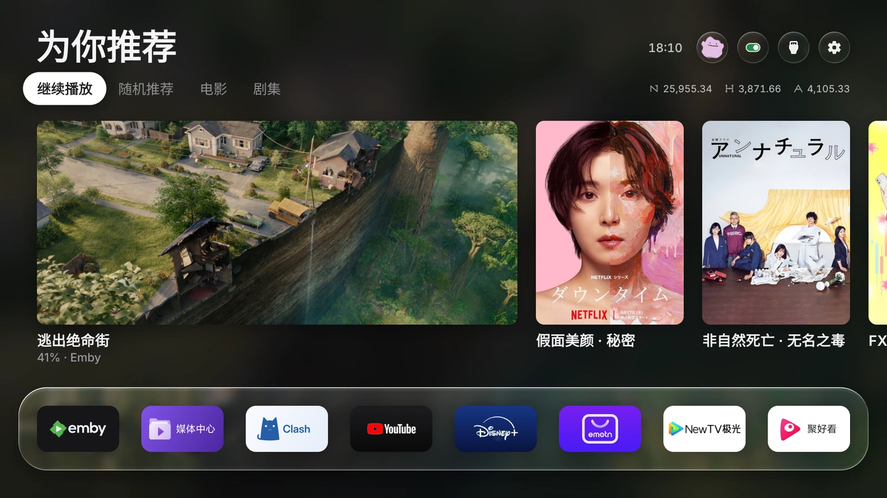

「繼續播放」獨立放在第一頁，主卡片顯示所選用戶的進度；點選時再次查詢，明確將起播位置交給官方 Emby 播放器。劇集依該用戶的觀看進度選擇接續集數。

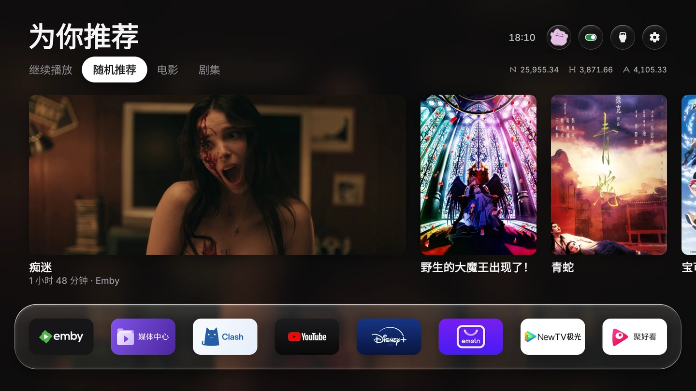

「隨機推薦」從自己的片庫挑選；劇集點選仍遵循該用戶觀看進度。第一張橫海報，後續豎海報向右連續滑動，每類最多 10 項，優先正式海報而非劇內截圖。深色背景跟隨當前焦點所對應的橫圖。

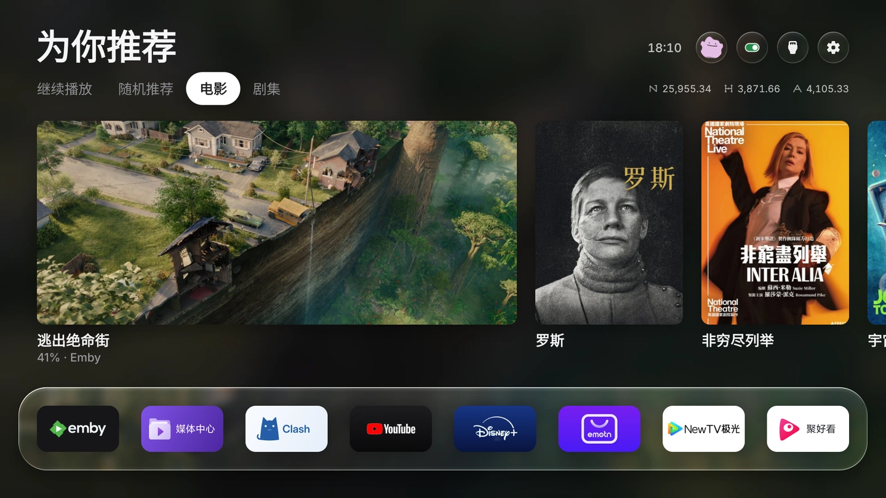

電影依最新入庫排序；已看過一部分仍按自己的進度續播。

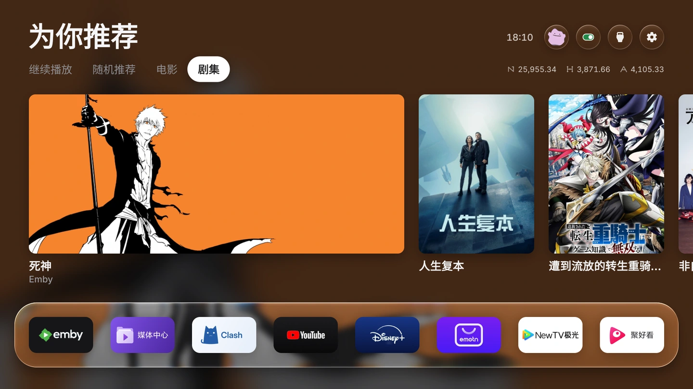

劇集依最新入庫的劇排列，播放對象則依用戶進度決定。無需電腦常駐：首頁每 30 分鐘同步，返回時更新；離開海報且 10 秒無操作才依序切分頁。右上小時鐘只在海報模式顯示。

## 首頁換帳號，播放器可選同步

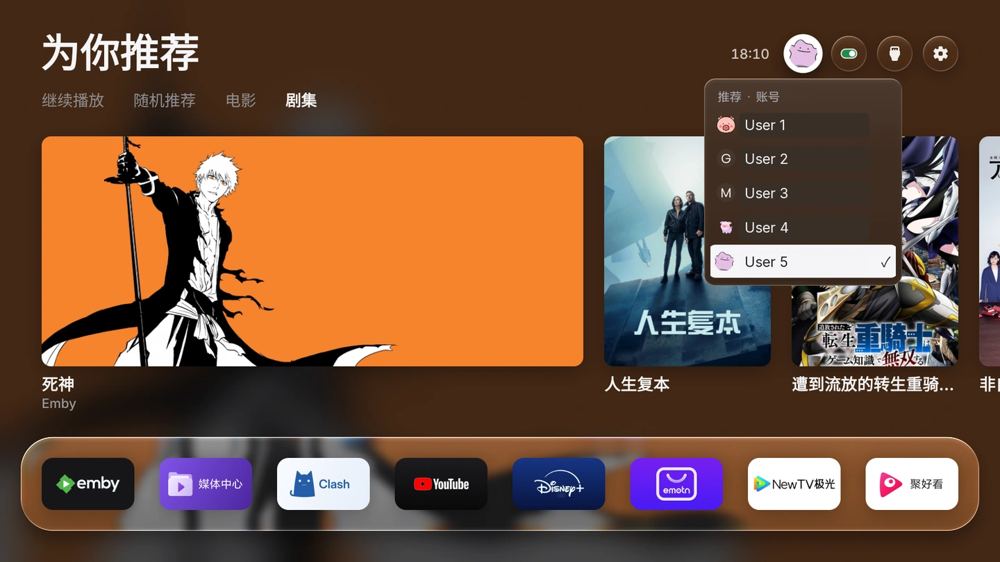

首頁下拉選單保持原色頭像與玻璃樣式，切換用戶後隔離推薦和快取。圖中 User 1–5 是為隱私替換的示意名稱，頭像保留原色。

選用「Emby 账号遥控」無障礙服務，可操作官方播放器的正常可見介面同步帳號；查核實際伺服器／用戶後才送出帶進度的播放要求。密碼和 PIN 由使用者手動完成，遇歧義或驗證失敗即停止。已測官方 Emby 3.5.35，其他版本需另驗證。

## 六個設定頁主題

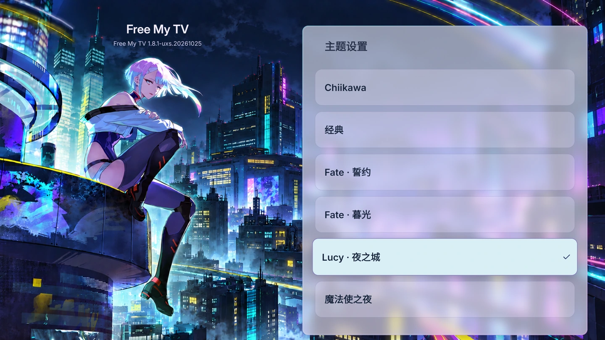

六個主題可在「主题设置」直接更換，與首頁明暗選項分開。每個插畫主題配有自己的色彩和面板；濾鏡快取在背景準備，不在每幀重新模糊整張背景。以下均為 1.8.1 設定主頁的實機畫面。

**Chiikawa／經典**

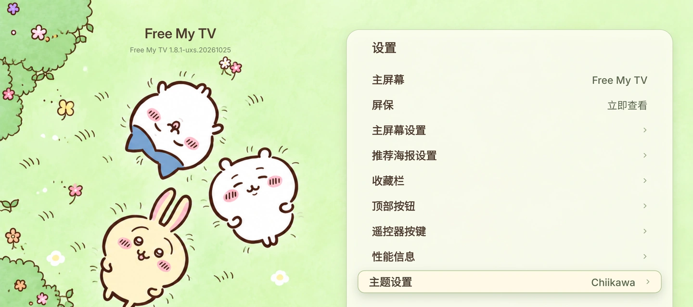 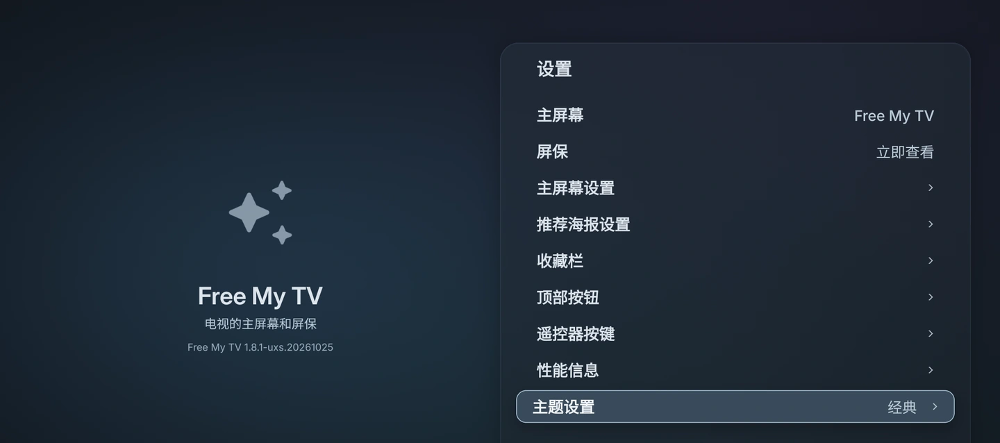

**Fate 誓約／Fate 暮光**

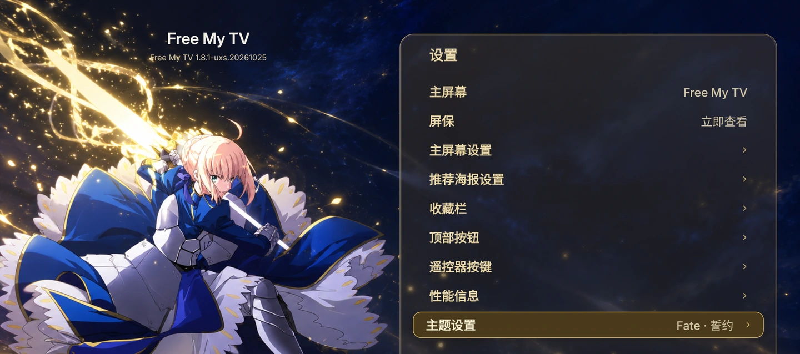 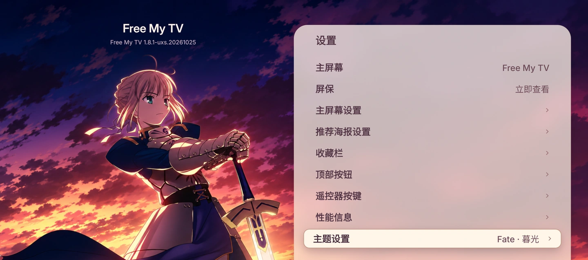

**Lucy 夜之城／魔法使之夜**

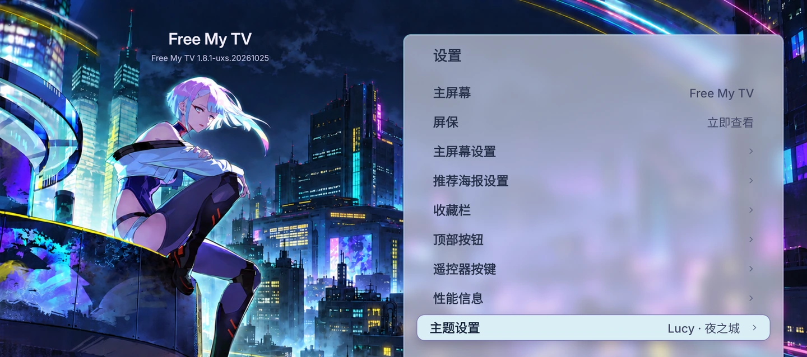 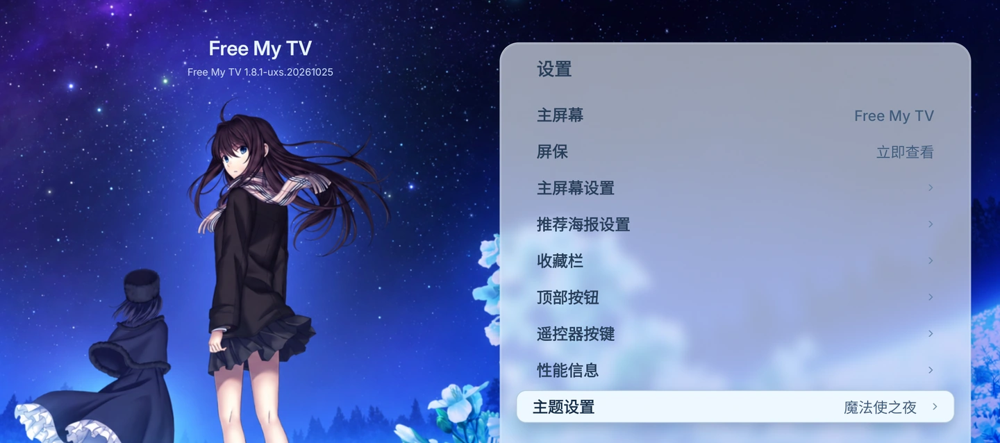

獨立「推荐海报设置」管理 Emby／TMDB 來源、伺服器、帳號、金鑰與 TMDB 地區；通知在主頁只留可展開的一條摘要，性能資訊另設一級入口。Lucy 夜之城以霓虹城市與冷色面板呼應角色；魔法使之夜採用無字星空花海背景。

## 海信單首頁、聚好看及調試控制

Home 從其他 App、聚好看或 HDMI 回 Free My TV；原廠 HDMI 選單保留。回首頁時交接至 Android 訊號源；保留全域 HDR、CEC 與校準設定。

聚好看可選「按需啟用」：平常停用並強停，只在主動開啟時放出，回新桌面後再封鎖；保留原套件和資料。新安裝需自行選擇這個模式，也可恢復「始終可用」。

上方截圖右上第二個按鈕的綠色內部表示調試已開。頂欄和下方快捷方式均能開／關；關閉後點聚好看會出現同風格啟用提示，成功後自動收起並繼續。需要安裝者選擇授予 WRITE_SECURE_SETTINGS，本版只寫開發者模式與 USB 調試，不操作獨立無線調試開關。

## 其他日常改進

- 導航：移動、確認、返回三種原創合成聲音，沒有 Apple TV 原音或手機外錄。
- 行情：納斯達克綜合 IXIC、恆生科技、滬深 300，使用免費騰訊 HTTPS 行情與來源時間；首頁可見三個一致風格的符號。
- 屏保：首頁預設閒置一分鐘，設定可選 1／2／5／10／15／30 分鐘；不覆蓋正在前景的影片或 HDMI。
- 頂部按鈕：Emby 帳號、調試、直播等可選擇是否顯示；天氣預設關閉，由新使用者設定自己的城市。
- 安裝：現成 APK、完整修改來源、Mac 工具、一次性 Emby／TMDB 金鑰輸入頁、獨立首次安裝 Skill 與校驗值。Windows／Linux 自備官方 adb。

## 統一的橫向應用卡片

首頁下方卡片沿用各 App 的標誌元素，以統一比例、獨立底色與清晰文字呈現。普通與選中狀態使用預先取樣、像素對齊的圖像；背景準備快取，保持導航流暢。

## 範圍與素材來源

圖片中的片庫、進度和頭像僅是經擁有者允許的文件示例，不作為公開包預設資料分發。UXS 已有 M 模式調試與使用者確認的 U 模式日常使用經驗；真機畫面來自同功能個人版。公開 APK 尚未完成乾淨電視首次安裝驗證。詳見 [版本驗證](HISENSE_RELEASE.md) 及 [首次安裝 Skill](../skills/hisense-uxs-freemytv-first-install/SKILL.md)。

角色插畫依使用者提供參考進行 AI 擴圖／改編，品牌標誌和影視海報屬各權利人；程式碼 MIT 不等於素材一概 MIT。見 [THIRD_PARTY_NOTICES](../THIRD_PARTY_NOTICES.md) 和 [圖片處理紀錄](assets/hisense/provenance.json)。
